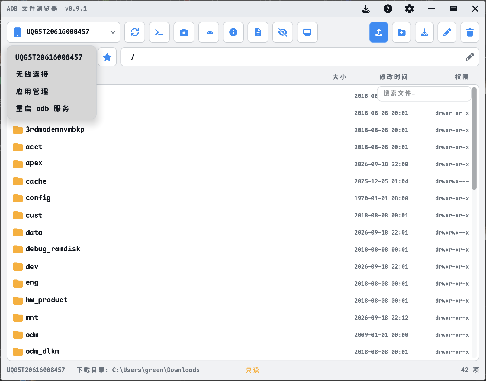

# ADB 文件浏览器（AdbTools）

一个基于 [EUI-NEO](https://github.com/sudoevolve/EUI-NEO) 框架、用 C++17 编写的 **Android ADB 文件管理器 + 工具箱**。自带设备文件浏览、上传/下载、截图、APK 安装、应用管理、scrcpy 投屏，以及 adb / scrcpy 的版本检测与一键更新。

- 界面：自绘无边框窗口 + 圆角 + 深色/浅色主题 + 自定义主题色 + 字体/字号/缩放设置
- 平台：Windows 10/11（MinGW-w64 编译）

---

## 截图

主界面（浅色主题）：



---

## 功能特性

- **设备管理**：自动探测 adb（SDK / PATH / 程序目录），列出并选择连接的设备，断线自动检测
- **文件管理**：浏览设备文件系统、多选、上传/下载、重命名、删除、新建文件夹、复制/移动（设备内剪贴板）、拖拽上传
- **路径导航**：可编辑路径栏、目录自动补全（**↑/↓ 选择、回车进入**，也可直接点）、后退/前进、快捷路径（书签，可起短别名并限定别名长度）、显示隐藏文件、按名称/大小/日期排序
- **常用命令**：内置「adb shell」与「宿主命令」两类常用命令，可自定义增删
- **截图 / 安装 APK / 设备信息 / 无线连接**
- **应用管理**：列出第三方应用、卸载、清除数据
- **文本 / 图片预览**：直接预览设备上的文本和图片；文本预览可以**搜索**（Ctrl+F 或点「查找」，实时高亮并计数，回车/箭头逐个跳转）
- **scrcpy 投屏**：内嵌到独立手机样式窗口，圆角、主题联动、窗口大小记忆
- **更新检测**：检测并一键更新 adb（Google 官方源）与 scrcpy（GitHub 官方源）
- **个性化**：深色/浅色主题、6 种主题色、系统字体/字重/字号、界面缩放（含动画）

---

## 下载与安装

到 [Releases](../../releases) 页面下载：

| 文件 | 说明 |
| --- | --- |
| `AdbTools-Setup-*.exe` | **推荐**。安装向导，自动创建开始菜单快捷方式（可选桌面快捷方式），并附带卸载程序。安装到用户目录（`%LOCALAPPDATA%\Programs\AdbTools`），无需管理员权限。 |
| `AdbFileBrowser-windows-x64.zip` | 便携版，解压后双击 `adb_browser.exe` 即可运行，无需安装。 |
| `AdbTools-tools-windows-x64.zip` | **可选**。adb + scrcpy（投屏用）。需要离线自带工具时再下，解压到程序目录即可（得到 `scrcpy\` 子目录）。 |

每个文件旁边都有对应的 `.sha256` 校验文件。

> **为什么 adb / scrcpy 不在主包里？**
> `adb.exe`、`scrcpy.exe` 和它们依赖的 DLL 是第三方二进制，**没有数字签名**。把它们一起打进压缩包，会让杀毒软件（尤其是 Windows Defender）把**整个下载包**报成病毒 —— 而且报的是压缩包本身，看起来就像我们的程序有毒。所以现在主包只装我们自己的程序，第三方工具单独发一个可选包。
> 程序在需要时会自己从官方源下载 adb / scrcpy，并校验官方公布的校验值，所以**完全不下这个可选包也能正常用**。

**首次启动会有一个「首次使用设置」对话框**：如果发现你缺 adb 或 scrcpy，它会列出两者的状态，并给「下载并安装」按钮，也可以点「全部下载」一次装好。装到程序目录，下载完立刻可用，不用重启。不想装投屏的话，勾上「不再提示」就不会再弹了。

**运行前提**：Windows 10/11；手机开启「开发者选项 → USB 调试」并用数据线连接授权（也支持无线调试：`adb connect <IP>:<端口>`）。

- 便携版解压后的目录结构、程序查找 adb 的顺序、以及找不到 adb 时怎么办：[docs/安装与运行.md](docs/安装与运行.md)

---

## 用电脑自己的程序编辑手机文件

手机上很多文件本程序没法编辑（Office 文档、PDF、代码、图片…）。现在在文件上**右键 → 「用电脑程序打开」**：

1. 程序把文件**下载**到本机（`程序目录\edit-cache\<设备>\<手机路径>`，保持原文件名，这样 Windows 才知道该用什么程序打开）；
2. 用你系统**默认关联的程序**打开它（.txt → 记事本、.jpg → 看图、.docx → Word……）；
3. **你在那个程序里一保存，改动就自动 `adb push` 回手机的原路径**（实测约 1–3 秒，程序在后台时稍慢），并提示「已同步到手机」。

工具栏上的**铅笔图标**打开「外部编辑」管理列表：每个文件显示状态（已同步 / 检测到改动 / 同步中 / 失败），可以「立即同步」或「停止」（停止前会把欠的改动先推回去）。可以同时编辑多个文件，各自监听、各自推回。

> 同步策略是**直接覆盖手机上的原文件**。如果手机上的同一文件在你打开之后又被别处改过，本地保存的内容会覆盖它。程序退出前会尽量把还欠着的改动推回去，避免刚改完就关程序而丢失。

---

## 命令行模式

**同一个 exe，两种模式**：不带参数开图形界面，带参数则执行命令后退出。

```bash
adb_browser.exe                       # 图形界面
adb_browser.exe devices               # 列出设备
adb_browser.exe list /sdcard/Download # 列目录（含可写标志）
adb_browser.exe push ./a.apk /sdcard/ # 上传；pull / rm / mkdir / shell / install / screenshot 同理
adb_browser.exe packages --json       # JSON 输出，便于脚本处理
```

- 退出码：`0` 成功 / `1` 操作失败 / `2` 用法错误；多设备时用 `--serial <序列号>` 指定
- 批量命令（push / pull / rm）会**尝试全部参数**并汇总 `已完成 N，失败 M` —— 与图形界面的批量操作同一条规则
- 图形界面与命令行共用 `core/` 的全部逻辑，不存在两份实现
- **完整命令表与说明**：[cli/README.md](cli/README.md)
- **要写集成/自动化、或让别的 AI 接入**：看 [cli/AI-INTEGRATION.md](cli/AI-INTEGRATION.md) ——
  逐字段的接口契约（stdout / JSON / 退出码 / 编码 / 超时，全部实测过），
  附一段可直接粘贴给 AI 的提示词，以及**没有手机时用假 adb 自测**的办法（`tools/fakeadb.cpp`）。

---

## 关于数字签名（本软件未签名）

**当前发布的版本没有数字签名**，因此：

- Windows 可能显示「未知发布者」，SmartScreen 可能提示"已阻止"；
- 个别杀毒软件可能误报（原因、白名单步骤与误报申诉见下方「杀毒软件报毒 / SmartScreen 拦截怎么办？」）。

这是**已知且预期**的情况，不是程序有问题。代码签名证书需要付费或有资格门槛（开源项目证书只能签发给法律实体），本项目目前不打算引入签名；如果你介意这一点，可以从源码自行编译（见下方「从源码编译」），或按下方说明把程序加入杀软白名单。

**隐私政策**：本程序**不会**在未经用户明确要求的情况下向任何联网系统传输信息。所有网络访问都只在你主动操作时发生：检查/执行 adb、scrcpy、本软件的更新（访问 Google 官方仓库与 GitHub Releases），以及你自己触发的下载。第三方组件的隐私政策请参见各自项目主页（[scrcpy](https://github.com/Genymobile/scrcpy)、[Android SDK Platform-Tools](https://developer.android.com/tools/releases/platform-tools)）。

---

## 杀毒软件报毒 / SmartScreen 拦截怎么办？

**先做一件事：核对哈希。** 每个发布文件旁边都有 `.sha256`；用 `certutil -hashfile <文件> SHA256`
算出来对比，一致就说明你下到的就是我们发布的那个文件（传输过程没被替换）。

- **程序没有数字签名**，所以 Windows 可能显示「未知发布者」、SmartScreen 可能提示"已阻止"。这不是中毒。
- Defender 报毒时在「病毒和威胁防护 → 排除项」里把**程序目录**加白名单（不要只加 exe，下载的 adb/scrcpy 也在里面）。
- 已经被隔离/删除：从隔离区恢复并按上面加白名单，然后重新解压一份。
- 火绒 / 360 / 卡巴斯基等：找「信任区 / 白名单 / 排除」，把程序目录加进去。

**完整说明（为什么会被报、逐步骤操作、怎么提交误报给微软、加白名单的代价）：**
[docs/杀毒软件与SmartScreen.md](docs/杀毒软件与SmartScreen.md)

---

## 从源码编译

### 依赖

- [MinGW-w64](https://www.mingw-w64.org/)（GCC **12 或更新**，含 `mingw32-make`）；推荐 [WinLibs](https://winlibs.com/) 或 MSYS2
- [CMake](https://cmake.org/) 3.14+
- Git

### 编译步骤

```bash
# 1. 克隆仓库
git clone --recursive https://github.com/joffeego/AdbTools.git
cd AdbTools

# 2. 配置（生成 MinGW Makefiles）
cmake -S . -B build -G "MinGW Makefiles" -DCMAKE_BUILD_TYPE=Release

# 3. 编译（并行）
cmake --build build --parallel
```

编译产物为 `build/adb_browser.exe`，字体资源会自动拷贝到 `build/assets/`。

> `3rd/EUI-NEO/` 是**已随仓库一起分发的框架源码**（含本项目的少量定制修改），CMake 使用 `EUI_DEPS_MODE=bundled` 全离线编译，不需要联网拉取依赖。

---

## 项目结构与开发

`main.cpp` 是界面与交互，`core/` 是**无 UI 依赖的纯逻辑**（这条规则由 CI 强制检查，不是靠自觉），
因此版本比较、更新包解析、sha256、原子写文件等都能脱离界面做单元测试。

```bash
cd build && ctest --output-on-failure    # 单元测试 + 真机端到端测试
ctest -LE device                         # 只跑单元测试（不需要设备）
```

**完整源码目录结构、架构说明、测试细节、新增代码放哪：** [docs/贡献与开发.md](docs/贡献与开发.md)

---

## 更新机制

「检查更新」对话框（标题栏最左侧下载图标）会检测并更新三样东西：

- **本软件**：从你配置的 GitHub 仓库 `releases/latest` 获取最新版本，点击「更新到 X」会下载、解压并替换 `adb_browser.exe`（更新完成后重启生效）。下载的升级包会先与 Release 公布的 **SHA-256** 校验值比对，不一致就中止安装；
- **adb**：从 Google 官方仓库 `dl.google.com/.../repository2-1.xml` 解析最新 platform-tools 版本（同时读取官方公布的校验值和准确的 Windows 包地址）；
- **scrcpy**：从 GitHub Releases API 获取最新版本，并校验发布方公布的 SHA-256（更新前会先关闭投屏释放文件占用）。


> 若网络无法访问 GitHub，对应行会显示「最新版本：未知」，不影响其它项。
> 发给维护者看的**发版流程**（版本号要同步改哪几处）见 [docs/贡献与开发.md](docs/贡献与开发.md)。

---

## 快捷键

| 按键 | 功能 |
| --- | --- |
| F5 | 刷新当前目录 |
| F2 | 重命名 |
| Backspace | 返回上级目录 |
| Enter | 打开选中的项（文件夹进入；文件按类型预览） |
| Delete | 删除选中项 |
| Ctrl+L | 编辑路径 |
| ↑ / ↓ | 编辑路径时在补全列表里选择（回车进入），列表两端停住不循环 |
| Ctrl+F | 打开搜索（文件列表；在「查看/编辑」里则是文件内查找） |
| Esc | 关闭当前弹窗（在「查看/编辑」里先关查找条，再关对话框） |

---

## 最近改了什么

> 🗑️ **0.10.28：按你的要求把 logcat 功能整个删掉（不是隐藏入口），另外修掉两处「闪一帧」。**
> - **logcat 已彻底移除**：工具栏入口、对话框、后台读取线程与管道、正则过滤、`logcat` 命令行子命令，以及相关单测和文档一并删除；只为它的过滤而存在的 `regex_wrap.cpp` 也删了。这是一次**破坏性**改动：命令行不再有 `logcat` 子命令。
> - **投屏窗口第一帧就在正确位置** —— 窗口其实是由框架在**下一帧**创建的（`openWindow` 只是把请求入队），所以以前只能靠一个轮询线程找到窗口后再 `SetWindowPos` 把它挪到屏幕中央，你看到的「先在别处闪一帧」就是这一步。现在屏幕坐标随请求一起传下去，在创建窗口的那一刻就摆好，轮询线程整个删掉。
> - **双击文件夹不再闪一帧列表顶部** —— 原因是进入目录时**过早**把滚动位置重置成 0，而那一刻列表里还是上一个文件夹的行，于是旧行被画在顶部。现在导航时不动滚动，改在「新列表装入」的同一帧里重置。
> - **顺带清掉一处死代码**：`commandLinePitch()` 自命令输出弹窗改用显式行高后就没人用了。

**更早的版本**：[CHANGELOG.md](CHANGELOG.md)（逐版本详情）· [Releases](../../releases)（下载与标签）

---

## 第三方组件与许可

本软件以 **Apache License 2.0** 开源。它使用了以下第三方组件（详见 [THIRD_PARTY_NOTICES.md](THIRD_PARTY_NOTICES.md)）：

- [EUI-NEO](https://github.com/sudoevolve/EUI-NEO)（Apache-2.0）—— UI 框架
- [scrcpy](https://github.com/Genymobile/scrcpy)（Apache-2.0）—— 投屏（运行时下载，不随源码分发）
- [Android SDK Platform-Tools (adb)](https://developer.android.com/tools/releases/platform-tools)（Apache-2.0）—— 调试桥（运行时下载，不随源码分发）
- 字体：Font Awesome 7 Free、JingNanJunJunTi、YouSheBiaoTiHei

---

## 免责声明

本项目仅供学习与合法的设备调试使用。请勿将其用于违反相关法律法规或侵犯他人权益的用途。使用本软件产生的一切后果由使用者自行承担。
